# Buddy sprites

Every animation of the buddy mod, drawn from the mod's real frame data. Images under `sheets/` and the tables marked generated are written by [`scripts/sheets.mjs`](../scripts/sheets.mjs), so they follow the code. Prose and tables that are not generated say so.

```
 hooks/clawd-moves.ts --+
 hooks/clawd-cues.ts ---+--> scripts/sheets.mjs --> docs/sheets/*.svg + index.json
 hooks/clawd.ts --------+                       \--> generated sections of this file
```

Design sources live on the board: [docs/board](board/README.md). The animations that react to the session are under [Cues](#cues).

## Sprite parts

The terminal Clawd is three rows of nine cells, built from a head, a body and a pair of feet. A pose is one of each. Generated from `HEAD`, `BODY` and `FEET` in `hooks/clawd-moves.ts`; `|` marks the ends of each nine-cell string.

<!-- parts:start -->
### HEAD

```
open     | ▐▛███▜▌ |
shut     | ▐█████▌ |
down     | ▐▙███▟▌ |
left     | ▐▜███▜▌ |
right    | ▐▛███▛▌ |
wink     | ▐▛████▌ |
```

### BODY

```
rest     |▝▜█████▛▘|
both     |▗▟█████▙▖|
left     |▗▟█████▛▘|
right    |▝▜█████▙▖|
```

### FEET

```
stand    |  ▘▘ ▝▝  |
step     |  ▝▝ ▘▘  |
sit      |  ▀▀ ▀▀  |
none     |         |
desk     | ▄▄▄▄▄▄▄ |
tapLeft  |  ▘▘     |
tapRight |     ▝▝  |
```

<!-- parts:end -->

## Poses

Not generated: hand-copied from the constants in `hooks/clawd-moves.ts` (only `STAND` is exported, so a generator cannot read the rest). Each pose is head, body, feet.

```
STAND                CHEER                AIR                  LEFT
| ▐▛███▜▌ |          | ▐▛███▜▌ |          | ▐▛███▜▌ |          | ▐▜███▜▌ |
|▝▜█████▛▘|          |▗▟█████▙▖|          |▗▟█████▙▖|          |▝▜█████▛▘|
|  ▘▘ ▝▝  |          |  ▘▘ ▝▝  |          |         |          |  ▘▘ ▝▝  |

RIGHT                UP                   SHUT                 WINK
| ▐▛███▛▌ |          | ▐▙███▟▌ |          | ▐█████▌ |          | ▐▛████▌ |
|▝▜█████▛▘|          |▝▜█████▛▘|          |▝▜█████▛▘|          |▝▜█████▛▘|
|  ▘▘ ▝▝  |          |  ▘▘ ▝▝  |          |  ▘▘ ▝▝  |          |  ▘▘ ▝▝  |
```

Turning around (`spin`, `turn`, `coin-hop`) steps through STAND, THREE_QUARTERS, EDGE, BACK, EDGE, THREE_QUARTERS_LEFT, STAND. BACK is the SHUT pose.

```
THREE_QUARTERS       EDGE                 BACK                 THREE_QUARTERS_LEFT
|  ▐█▛██▌ |          |   ▐██▌  |          | ▐█████▌ |          | ▐██▜█▌  |
| ▝▜████▛▘|          |   ▝███▘ |          |▝▜█████▛▘|          |▝▜████▛▘ |
|   ▘▘ ▝▝ |          |    ▝▝   |          |  ▘▘ ▝▝  |          | ▘▘ ▝▝   |
```

A frame can also push the sprite down or sideways inside the box (clipping it) and add dust or a shadow mark. That is how he hides, peeks and walks out of sight.

## Click animations

Terminal only (fullscreen). A click on Clawd plays one of these, each frame for 70 ms, from a shuffled deck: every one plays before any repeats, never the same one twice in a row, and clicks during an animation are ignored. `hooks/clawd-term.tsx` plays them via `dealClicks`, and each ends on STAND. The animated image loops; the sheet shows every frame in order.

Generated from `CLICKS` and `CLICK_MS`. A new key in `CLICKS` appears here after a regenerate.

<!-- clicks:start -->
### jump

13 frames at 70 ms, loop 910 ms.


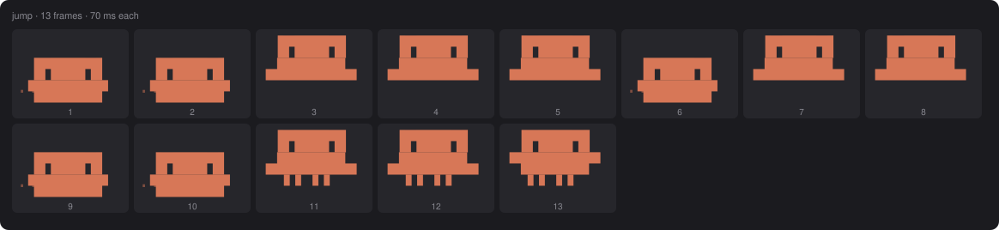

### look

16 frames at 70 ms, loop 1120 ms.


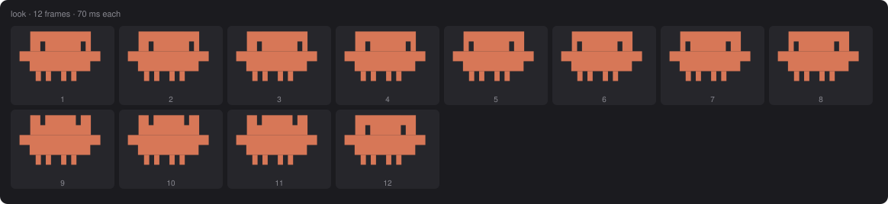

### spin

17 frames at 70 ms, loop 1190 ms.


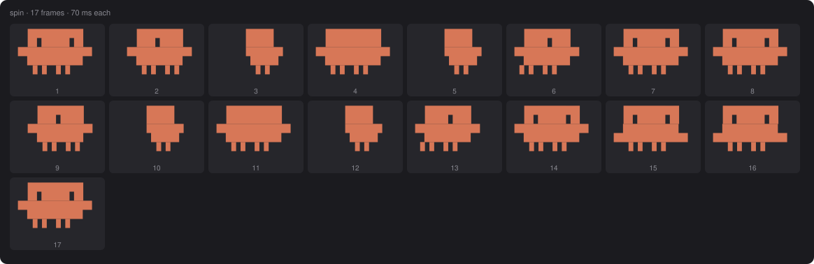

### peekaboo

18 frames at 70 ms, loop 1260 ms.


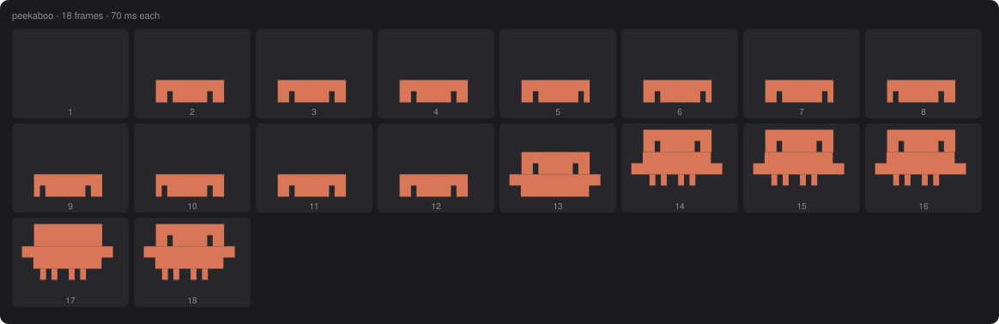

### drop

12 frames at 70 ms, loop 840 ms.


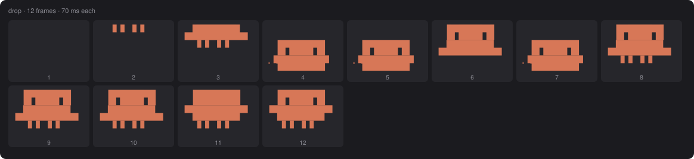

### wink

14 frames at 70 ms, loop 980 ms.


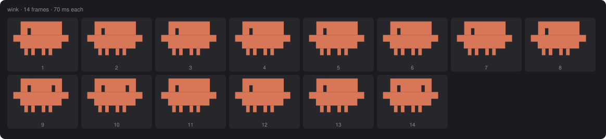

### boop

13 frames at 70 ms, loop 910 ms.


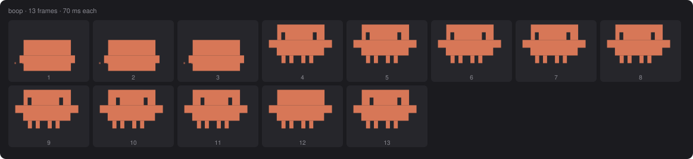

### tap

15 frames at 70 ms, loop 1050 ms.


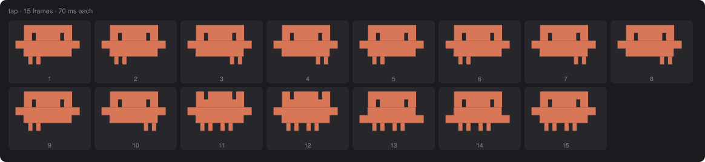

### sneeze

14 frames at 70 ms, loop 980 ms.


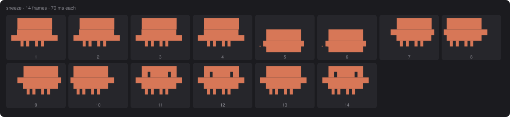

### turn

15 frames at 70 ms, loop 1050 ms.


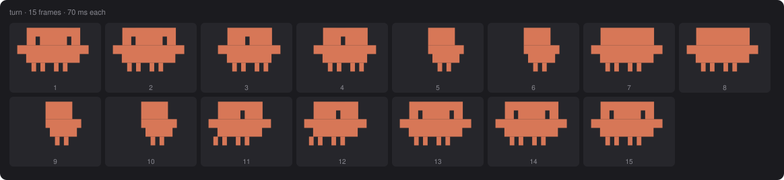

### coin-hop

14 frames at 70 ms, loop 980 ms.


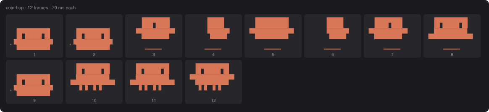

### skip

13 frames at 70 ms, loop 910 ms.


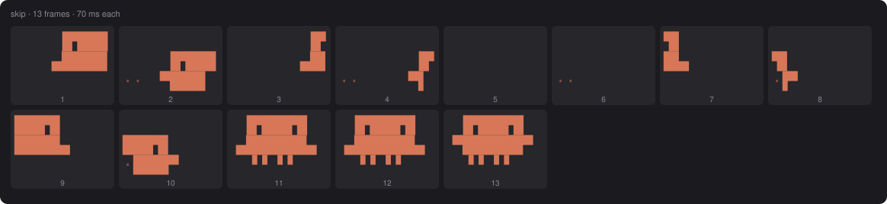

### waddle

27 frames at 70 ms, loop 1890 ms.


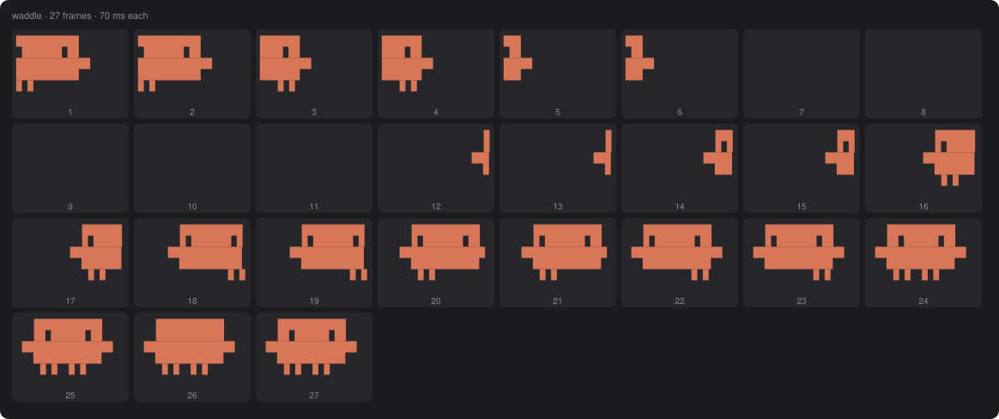

### peek

27 frames at 70 ms, loop 1890 ms.


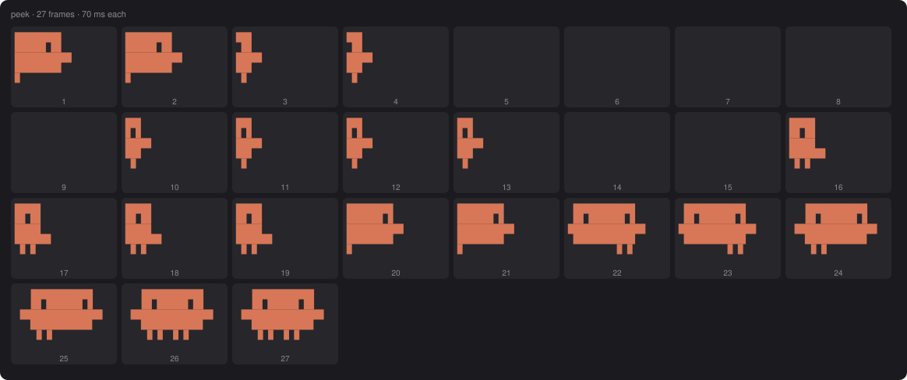

<!-- clicks:end -->

## Work modes and strain reactions

Not generated. The terminal Clawd draws these in `hooks/clawd-term.tsx` (a React render the generator cannot run), so they are not in `sheets/`. The board shows them animated ([Main.dc.html](board/README.md)). The table is hand-copied from `register.tsx` (triggers) and `DOING` in `clawd-term.tsx` (label).

| Activity | Label | Trigger |
| --- | --- | --- |
| think | `… thinking` | turn started, no tool running (paces on his feet) |
| laptop | `⌨ typing` | an ordinary Bash command |
| test | `◔ testing` | Bash: `test`, `pytest`, `jest`, `vitest`, `mocha` |
| git | `◆ git` | Bash starting with `git` |
| install | `↓ installing` | Bash: `npm`, `pnpm`, `yarn`, `bun`, `pip`, `brew`, `apt`, `cargo`, `gem` with `install`, `add`, `i` or `ci` |
| build | `▤ building` | Bash: `build`, `tsc`, `make`, `compile`, `webpack`, `gradle`, `mvn` |
| hammer | `✎ editing` | Edit, Write, NotebookEdit |
| magnify | `⌕ reading` | Read, Grep, Glob |
| web | `◎ browsing` | WebFetch, WebSearch |
| agents | `⚑ delegating` | Agent |
| notes | `☑ planning` | TodoWrite, TaskCreate, TaskUpdate |
| ask | `? asking` | AskUserQuestion |
| mcp | `↯ connecting` | any `mcp__` tool |
| skill | `✦ casting` | Skill |
| plan | `◇ drafting` | EnterPlanMode, ExitPlanMode |

Only the main agent's tools count. Bash commands are matched in the order git, test, install, build.

Strain reactions sit on top of idle or working. The pixel versions are generated below; the terminal versions are on the board only.

| Strain | Trigger | Terminal | Pixel |
| --- | --- | --- | --- |
| hot | any limit or the context at 85% or more | `°` falls beside him | sweat runs down his left side |
| slow | one tool running 10 seconds or more (Agent excluded) | a clock hand turns (`◴◷◶◵`) | a clock hand turns above his shoulder |
| cold | the prompt cache has gone cold (needs cache-timer) | `*` falls, he shivers | snow drifts down his right side |

If several apply, hot wins, then slow, then cold.

## Pixel Clawd

Desktop, VS Code and mobile draw a pixel Clawd (`draw` in `hooks/clawd.ts`): 19 by 12 pixels, `C` body, `E` eye, one palette letter per prop color. Drawn here at 6x on a dark card, in the classic skin. The live version is one self-animating SVG that also plays a loved hop on click; that click reaction is not generated.

Moods come from `FRAME_MS` and `LOOP`; the mood follows the turn (working while a turn runs, happy or oops for a moment after, a yawn and then asleep after 2 minutes idle). The pixel Clawd has one prop per kind of tool, and the newer activities borrow the closest one (listed under each prop).

<!-- pixel:start -->
### Moods

#### idle

40 frames at 300 ms, loop 12000 ms.


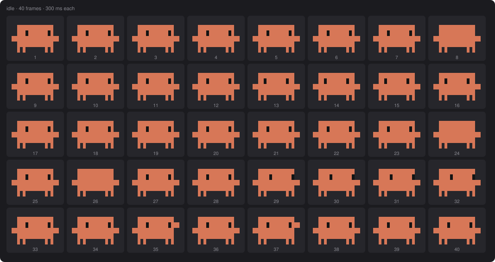

#### drowsy

8 frames at 450 ms, loop 3600 ms.


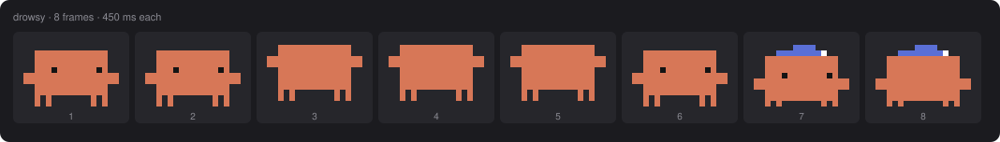

#### working

8 frames at 200 ms, loop 1600 ms.


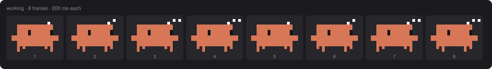

#### happy

8 frames at 160 ms, loop 1280 ms.


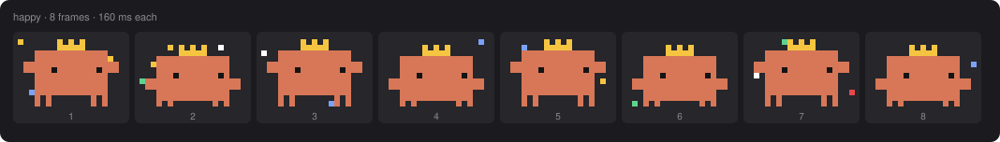

#### oops

8 frames at 90 ms, loop 720 ms.


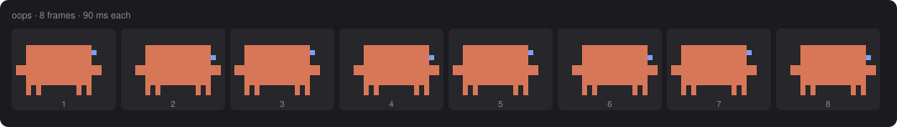

#### asleep

3 frames at 900 ms, loop 2700 ms.

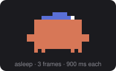

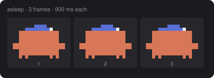

#### loved

10 frames at 140 ms, loop 1400 ms.


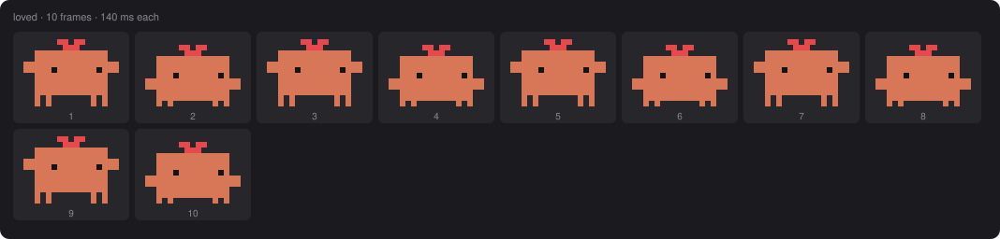

### Activity props (working mood)

#### think

8 frames at 200 ms, loop 1600 ms. Also used for: ask, plan.


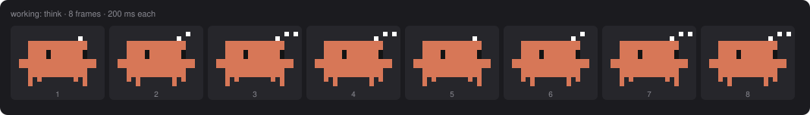

#### laptop

8 frames at 200 ms, loop 1600 ms. Also used for: test, git, install.


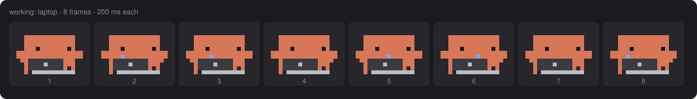

#### hammer

8 frames at 200 ms, loop 1600 ms. Also used for: build.


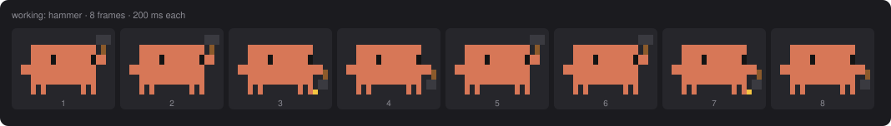

#### magnify

8 frames at 200 ms, loop 1600 ms. Also used for: nothing else.


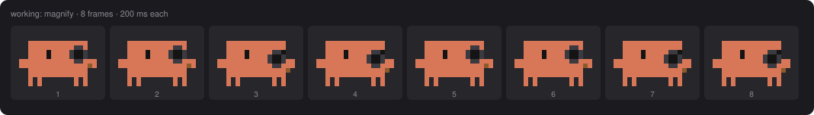

#### notes

8 frames at 200 ms, loop 1600 ms. Also used for: skill.



#### web

8 frames at 200 ms, loop 1600 ms. Also used for: mcp.


#### agents

8 frames at 200 ms, loop 1600 ms. Also used for: nothing else.


### Strain reactions (working, thinking)

#### hot

8 frames at 200 ms, loop 1600 ms.


#### cold

8 frames at 200 ms, loop 1600 ms.


#### slow

8 frames at 200 ms, loop 1600 ms.


### Skins

| Skin | Hex |
| --- | --- |
| classic | `#d77757` |
| ink | `#e8e6e3` |
| mint | `#7fd1ae` |
| sky | `#7aa2f7` |
| berry | `#e07ab0` |
| gold | `#e5c07b` |


<!-- pixel:end -->

## Cues

A cue is a full look for a state of the session: Clawd in the middle with a column of cells (or pixels) beside him, shown in place of his mood while it lasts. Every cue has a terminal version (`hooks/clawd-cues.ts`, `CUES`) and a pixel version (`hooks/clawd.ts`, `PIXEL_CUES`) with the same frame count, frame time and still frame. Triggers and priority live in `hooks/register.tsx`. These started as the twelve proposals on the design board ([docs/board](board/README.md)); the board now matches what is implemented.

```
 trigger --> play(cue) --> pickCue (lowest rank wins) --> terminal Client or pixel Svg
 sticky signals (perm, limit, compact, coffee, agents) stay while their cause lasts
 one-shots (the rest) play their frames once; a less urgent one cannot cut in on a more urgent one
```

Priority, most urgent first. Not generated: copied from `RANK` in `hooks/register.tsx`.

| Rank | Cues | Why |
| --- | --- | --- |
| 0 | perm | he is waiting on you |
| 1 | error, offline, limit | something is wrong |
| 2 | pass, fail, flag, hello, fireworks | one-shot events |
| 3 | compact, agents, coffee, bigfile | long states |
| none | normal mood and activity | nothing special is going on |

Equal ranks: the one-shot already playing wins over a sticky cue, then `perm`, `limit`, `compact`, `coffee`, `agents` in that order.

### Subagents

While subagents the main agent spawned are still running, Clawd shows the `agents` cue (clones and the count) once the main chat is not in a turn. That includes after the main turn ended: he shows the clones until the last subagent finishes. During a main turn his normal activity (the agents prop, under Pixel Clawd) shows instead, and subagents' own tools never move him.

Generated from `CUES` and `PIXEL_CUES`. A new key in either appears here after a regenerate, with one exception: its trigger text must be added to `TRIGGERS` in `scripts/sheets.mjs`, or the run stops. The `agents` cue is drawn with 2 clones and the `flag` cue with the hash `1a2b3c4`; the live ones use the real count and hash.

<!-- cues:start -->
### perm

**Trigger:** A permission prompt opens on you (`tool.check` asks and nobody else decides). Loops until that tool call ends or the main turn completes.

Terminal: 6 frames at 180 ms, loop 1080 ms. Pixel: 6 frames at 180 ms, loop 1080 ms.

**Terminal**


**Pixel**


### error

**Trigger:** A main-agent tool result is an error, or the tool threw, and it was not a test run, a denial or a background start. Plays once.

Terminal: 9 frames at 170 ms, loop 1530 ms. Pixel: 9 frames at 170 ms, loop 1530 ms.

**Terminal**


**Pixel**


### pass

**Trigger:** A test command succeeds: `npm`, `pnpm`, `yarn` or `bun` `test`, `pytest`, `jest`, `vitest`, `mocha`, `phpunit`, `rspec`, `go`, `cargo`, `mvn`, `gradle`, `dotnet`, `deno`, `swift` or `flutter` `test`, `claude plugin test`. Plays once.

Terminal: 8 frames at 190 ms, loop 1520 ms. Pixel: 8 frames at 190 ms, loop 1520 ms.

**Terminal**


**Pixel**


### fail

**Trigger:** The same test commands fail. Plays once.

Terminal: 8 frames at 190 ms, loop 1520 ms. Pixel: 8 frames at 190 ms, loop 1520 ms.

**Terminal**


**Pixel**


### compact

**Trigger:** Context compaction: `session.compact` of the main agent, plus an always-on fallback for hosts that never send it (the request carries fewer than half the previous messages, from 6 messages up). Loops while it runs; the fallback shows it for one pass.

Terminal: 9 frames at 120 ms, loop 1080 ms. Pixel: 9 frames at 120 ms, loop 1080 ms.

**Terminal**


**Pixel**


### limit

**Trigger:** A rate limit is at 100% (`session.measure`) or a turn stopped on a rate limit (`classic.StopFailure`). Loops until a main turn ends with an answer.

Terminal: 8 frames at 300 ms, loop 2400 ms. Pixel: 8 frames at 300 ms, loop 2400 ms.

**Terminal**


**Pixel**


### agents

**Trigger:** Subagents spawned by the main agent (not nested, not workflow) are still running. Shows clones and the count, up to 3 clones, while the main chat is not in a turn, so it also shows after the main turn ended.

Terminal: 4 frames at 200 ms, loop 800 ms. Pixel: 4 frames at 200 ms, loop 800 ms. Drawn with 2 clones.

**Terminal**


**Pixel**


### coffee

**Trigger:** A main-agent tool (not `Agent`) has run for 30 seconds. Loops until it returns.

Terminal: 8 frames at 250 ms, loop 2000 ms. Pixel: 8 frames at 250 ms, loop 2000 ms.

**Terminal**


**Pixel**


### bigfile

**Trigger:** A `Read` returns 500 or more lines. Stays up for a few seconds.

Terminal: 24 frames at 125 ms, loop 3000 ms. Pixel: 24 frames at 125 ms, loop 3000 ms.

**Terminal**


**Pixel**


### offline

**Trigger:** A main turn ends with an error and no rate limit is showing, which is taken for the network. Stays up until the next answer or its time runs out.

Terminal: 8 frames at 160 ms, loop 1280 ms. Held for 20000 ms. Pixel: 8 frames at 160 ms, loop 1280 ms.

**Terminal**


**Pixel**


### flag

**Trigger:** A `git commit`, `git push` or `gh pr create` succeeds (not `--dry-run`). A commit shows its short hash. Plays once.

Terminal: 10 frames at 150 ms, loop 1500 ms. Pixel: 10 frames at 150 ms, loop 1500 ms.

**Terminal**


**Pixel**


### hello

**Trigger:** A fresh launch: the session starts with an empty transcript (resumes and `/clear` do not count). Plays once.

Terminal: 18 frames at 100 ms, loop 1800 ms. Pixel: 18 frames at 100 ms, loop 1800 ms.

**Terminal**


**Pixel**


### fireworks

**Trigger:** A main turn ends with an answer after 5 minutes or more. Plays once.

Terminal: 12 frames at 130 ms, loop 1560 ms. Pixel: 12 frames at 130 ms, loop 1560 ms.

**Terminal**


**Pixel**


<!-- cues:end -->

## Regenerate

```
node mods/ui/buddy/scripts/sheets.mjs
```

Run from the repo root, needs Node 22.18 or newer (it imports the `.ts` hook files directly, no install). It rewrites `docs/sheets/` (every `.svg` and `index.json` in it is replaced) and the generated sections of this file. Output is deterministic.

What it iterates: `CLICKS` and `CLICK_MS` from `clawd-moves.ts`; `CUES` and `playMs` from `clawd-cues.ts`; `FRAME_MS`, `LOOP`, `SKINS` and `PIXEL_CUES` from `clawd.ts`. The `Activity` and `Strain` lists are not exported as values, so they are read from the unions in `types/index.d.ts`. Activities that draw identical frames to an earlier one are listed as aliases in `docs/sheets/index.json` instead of getting their own file.
